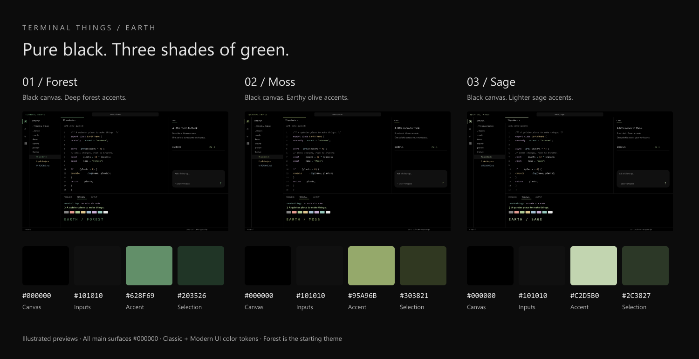

# Nosa's stuff for dev
This is Nosa's config files, AGENTS.md, CLAUDE.md and skills.

## Machine fleet and agent skills

[Fleet setup](agentshi/FLEET.md) documents SSH access between Newera (the main PC),
Godseye, Shitbook, and Ewaste. Public SSH configuration lives in `configs/ssh`;
the maintained 1Password sudo-access skill lives in `agentshi/skills`.

## VS Code: Earth

[Terminal Things — Earth](themes/earth/README.md) is an AMOLED black VS Code theme with Forest, Moss, and Sage green accents, matching terminal colors, and support for classic and Modern UI.

## Windows remote host: Godseye

Godseye is configured to stay awake with the laptop lid closed and bring its
remote services back at system startup. Keep it plugged in and leave the vents
clear when storing it somewhere to run unattended. Battery exhaustion or loss
of power can still shut it down.

The files in [`configs/windows`](configs/windows/README.md) capture this setup:

| File | Purpose |
| --- | --- |
| [`Set-AlwaysAwake.ps1`](configs/windows/Set-AlwaysAwake.ps1) | Backs up the active Windows power plan, disables automatic sleep/hibernation and the unattended sleep timer, and makes closing the lid do nothing on AC and battery. Run elevated on the intended host. |
| [`Start-T3Code.ps1`](configs/windows/Start-T3Code.ps1) | Runs the NPX T3 nightly server headlessly using the existing user's T3 Connect link, waits for Tailscale, and writes private startup logs. |
| [`Install-T3CodeStartup.ps1`](configs/windows/Install-T3CodeStartup.ps1) | Installs the T3 boot/sign-in task under the linked user's account, with automatic recovery and no desktop login required. Run elevated as that user with the launcher beside it. |
| [`GodseyeWebProxy.go`](configs/windows/GodseyeWebProxy.go) | Source for the loopback web gateway behind Tailscale: serves Sunshine at `/sunshine` and redirects `/t3` to T3's dedicated HTTPS endpoint. This gateway is specific to Godseye. |
| [`Windows README`](configs/windows/README.md) | Full startup inventory, installed paths, Tailscale routes, T3 update instructions, checks, and backup locations. |

Tailscale, Sunshine, its web gateway, T3 Code, SSH, and RustDesk start at boot.
T3 uses the existing `.t3` account and project data; `connect` is the initial
authorization step and `serve` is the long-running process. Updates are manual;
the boot wrapper favors the cached nightly build.

The web entry addresses are
[`/sunshine`](https://godseye.tail3123d8.ts.net/sunshine) and
[`/t3`](https://godseye.tail3123d8.ts.net/t3), accessible within the tailnet.
T3 redirects to HTTPS port 8443 because its UI expects to run at the website
root. Both entry paths are lowercase.

Keeping the computer awake does not guarantee Sunshine can capture the screen
with the lid closed. Its dashboard, T3, and SSH can remain available; reliable
screen-off streaming may require a virtual display or HDMI dummy plug. No
virtual display is installed by these scripts.
